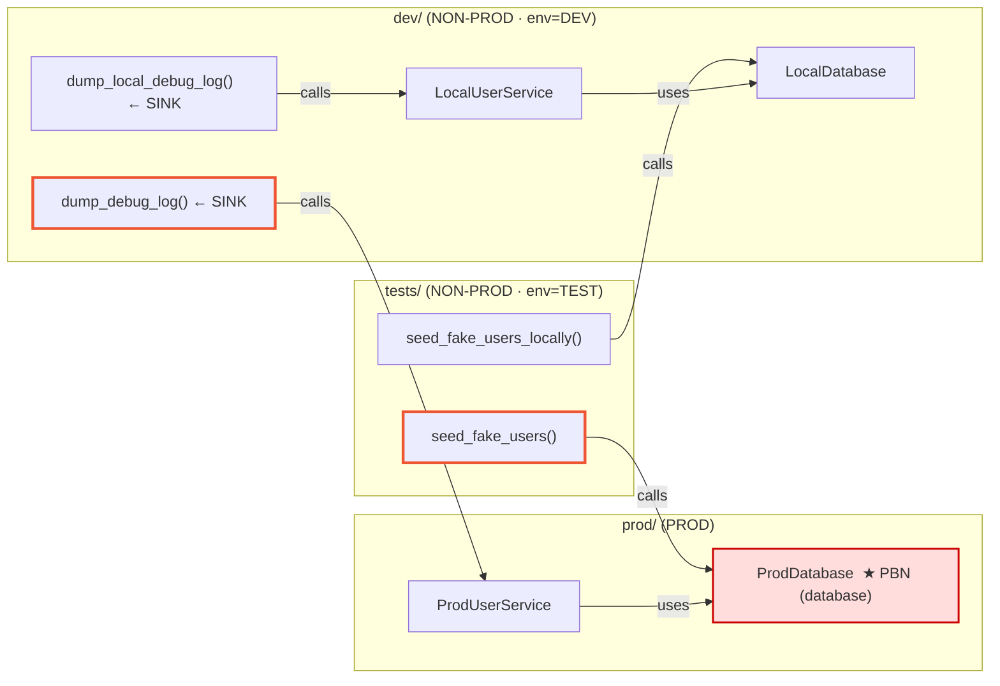
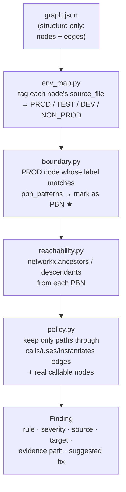

# Tempest — The `graph.json` Structure (graphify output)

Everything in Tempest's structural tier rides on one file: the `graph.json`
that `graphify update` writes to `<repo>/.tempest/graphify-out/`. This doc
describes that file's exact shape, field by field, with diagrams drawn from a
**real** graph — the `tests/fixtures/leaky_repo/` fixture (48 nodes, 55 edges).

Companion to `TEMPEST_ARCHITECTURE.md` (§3) and `TEMPEST_LANDSCAPE_AND_BENCHMARKING.md`.

---

## 1. Top-level shape

`graph.json` is **NetworkX node-link JSON**. Four top-level keys:

```json
{
  "input_tokens":  1234,        // graphify's own bookkeeping — Tempest ignores
  "output_tokens": 567,         // graphify's own bookkeeping — Tempest ignores
  "nodes": [ { ... }, ... ],    // the code entities
  "links": [ { ... }, ... ]     // the relationships (edges)
}
```

```
graph.json
├── input_tokens    ─┐  graphify accounting, unused by Tempest
├── output_tokens   ─┘
├── nodes[]  ──────────►  functions, methods, classes, modules, rationale prose
└── links[]  ──────────►  directed edges: contains / calls / uses / imports / method / rationale_for
```

> ⚠️ There is **no top-level `"directed"` key**. NetworkX's loader would default
> to an undirected graph, so `graph_loader.py` forces a `DiGraph` explicitly —
> direction matters because the whole detection idea is *reachability*.

---

## 2. Node anatomy

Every node carries **exactly these 6 fields** — no more, no less:

```json
{
  "id": "dev_local_db_localdatabase",
  "label": "LocalDatabase",
  "file_type": "code",
  "source_file": "dev/local_db.py",
  "source_location": "L7",
  "_origin": "ast"
}
```

| Field | Example | What it is | How Tempest uses it |
|-------|---------|-----------|---------------------|
| `id` | `dev_local_db_localdatabase` | Stable unique key | Node identity everywhere; keys the classification dict |
| `label` | `dump_local_debug_log()` | Human name of the entity | Matched vs `pbn_patterns` (DB/storage?) & `sink_patterns` (log/debug?); the `()` suffix marks a real callable |
| `file_type` | `code` \| `rationale` | Kind of node (see below) | `rationale` nodes are filtered out of findings |
| `source_file` | `dev/local_db.py` | Repo-relative path | **Drives PROD/NON-PROD env tagging** + Rule (a)'s literal scan |
| `source_location` | `L7` | Line reference | Presence distinguishes concrete code nodes from synthetic ones |
| `_origin` | `ast` | Provenance | Says this came from AST parsing (not LLM) |

### Three flavors of node you'll actually see

```
┌─────────────────────────┬───────────────────────────────┬──────────────────────────────┐
│ MODULE / FILE node       │ CALLABLE node                 │ RATIONALE node               │
├─────────────────────────┼───────────────────────────────┼──────────────────────────────┤
│ label: "local_db.py"     │ label: "get_user_record()"    │ file_type: "rationale"       │
│        "__init__.py"     │        "LocalDatabase"        │ label: "Local development DB │
│ source_location: L1      │        ".connect()"           │   stub. NON-PROD, not a PBN."│
│ file_type: code          │ file_type: code               │ (a prose SENTENCE, ends '.') │
│                          │ has real source_location      │                              │
│ → structural container   │ → the nodes RULES CARE ABOUT  │ → NOISE, filtered everywhere │
└─────────────────────────┴───────────────────────────────┴──────────────────────────────┘
```

- **Module/file nodes** — one per file, the container.
- **Callable nodes** — functions (`foo()`), classes (`LocalDatabase`), methods
  (`.connect()`). These are what Rules (a)/(b)/(c) select as sources, sinks, and
  boundaries.
- **`rationale` nodes** — graphify's generated prose commentary about a file.
  Their `label` is a full sentence ending in `.`. Tempest spends real code in
  `policy.py` filtering these out (labels ending/starting with `.`). In the
  fixture, **~1/3 of all nodes are rationale** — pure overhead for Tempest.

---

## 3. Edge (link) anatomy

Edges are richer than nodes. Each has 7 common fields (2 optional):

```json
{
  "source": "tests_seed_script_seed_fake_users",
  "target": "prod_db_proddatabase",
  "relation": "calls",
  "context": "call",              // optional (present on ~1/3)
  "confidence": "EXTRACTED",       // EXTRACTED (parsed) vs INFERRED (guessed)
  "source_file": "tests/seed_script.py",
  "source_location": "L12",
  "weight": 1.0                    // 1.0 for EXTRACTED, <1.0 for INFERRED
}
```

### The `relation` field is the important one

It's what separates "real data path" from "structure/noise". Distribution in the
fixture:

| relation | count | meaning | data path? |
|----------|-------|---------|-----------|
| `rationale_for` | 15 | prose node → what it describes | ❌ noise |
| `contains` | 10 | module → its functions/classes | ❌ structural |
| `method` | 10 | class → its methods | ❌ structural |
| `imports_from` | 6 | file → file it imports from | ❌ structural |
| `imports` | 6 | file → the symbol imported | ❌ structural |
| **`calls`** | 6 | function calls another | ✅ **real path** |
| **`uses`** | 2 | inferred usage relationship | ✅ **real path** |

Tempest's `write_edge_relations` config = `{calls, instantiates, uses}`. **Only
those count** as "non-prod code reaches a prod resource." Everything else is
containment/imports/noise and is ignored by the reachability rules.

### `confidence` / `weight` — present but IGNORED

graphify tags every edge:
- `EXTRACTED` (weight `1.0`) — hard-parsed from the AST, high trust
- `INFERRED` (weight `0.8`) — graphify *guessed* the relationship

In the fixture, the two `uses` edges are `INFERRED` (0.8). **Tempest treats an
inferred guess identically to a hard-parsed fact** — it never reads `confidence`
or `weight`. Gating/weighting on these is an obvious untapped precision lever
(see arch doc).

---

## 4. A real graph, drawn out

Below is the actual structure of `leaky_repo`, simplified to the callable nodes
and the `calls`/`uses` edges that matter. Three sibling worlds — `tests/`,
`dev/`, `prod/` — each with a UserService and a Database.



**Two planted leaks light up:**

**Rule (b) — test code reaches a prod DB:**
```
tests/seed_script.py :: seed_fake_users()  ──calls──►  ProdDatabase  ★PBN(database)
        NON-PROD (env=TEST)                                    PROD boundary node
        ▲ this edge = the finding
```

**Rule (c) — a debug sink reaches prod data:**
```
dev/debug_utils.py :: dump_debug_log()  ──calls──►  ProdUserService  ──uses──►  ProdDatabase
        SINK (label matches log/debug/dump)              PROD                    PROD data
        ▲──────────────── the leak path (evidence) ───────────────────────────────────►
```

**And the false-positive controls stay quiet** — their identical-shaped siblings
point at `LocalDatabase` / `LocalUserService`, which are NON-PROD, so no PBN is
reached and nothing fires.

---

## 5. From `graph.json` to a finding — what Tempest layers on

graphify gives Tempest **structure only**. Every security *meaning* is added
afterward. This is the key mental model:



| graphify provides | Tempest adds |
|-------------------|--------------|
| Nodes + edges | Which nodes are PROD vs NON-PROD |
| `label` strings | Which labels are resource **boundaries** (PBNs) |
| `source_file` paths | Env classification (TEST/DEV/PROD) from those paths |
| `calls`/`uses`/… relations | Which relations count as a real "reach" |
| Raw reachability substrate | The 3 leak policies + evidence-path reconstruction |

So: **graphify answers "what connects to what." Tempest answers "and which of
those connections is a leak."**

---

## 6. Gotchas the code works around (all rooted in graph.json quirks)

These are real defensive measures in `policy.py`, each traceable to something in
the graph:

1. **Backwards edges.** graphify sometimes emits `PBN → test` instead of
   `test → PBN`. Rule (b) therefore checks both `nx.ancestors` *and*
   `nx.descendants` of each PBN (`policy.py:57`).
2. **No write-edge type.** There is no `writes` relation — only `calls`/`uses`.
   So Rule (b) cannot distinguish a destructive write from a read-only call; a
   read into a prod DB from test code matches too. This is *the* core precision
   limit and the whole reason `V1.03-Semantic` adds an LLM WRITE/READ check.
3. **Spurious 2-node hops.** Bogus direct edges appear as length-2 paths; Rule
   (c) requires the sink's first hop to be a genuine prod node to filter them
   (`policy.py:187`).
4. **Rationale prose.** Sentence-labeled nodes must be excluded or they multiply
   findings — filtered by the trailing-`.` label check throughout.

---

## 7. Cheat sheet

```
NODE  = { id, label, file_type(code|rationale), source_file, source_location, _origin }
EDGE  = { source, target, relation, confidence(EXTRACTED|INFERRED), weight, source_file, source_location, [context] }

relations that mean "reaches":   calls · uses · instantiates
relations that are just structure: contains · method · imports · imports_from
relations that are noise:          rationale_for

PBN  = a PROD node whose label matches a database/storage/messaging/network pattern
LEAK = a NON-PROD callable that reaches a PBN through a calls/uses/instantiates path
```
