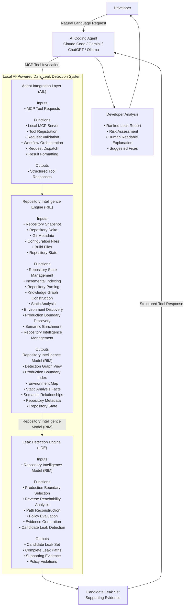

# High-Level Architecture

## Local AI-Powered Data Leak Detection System



---

# Responsibility Matrix

| Component | Inputs | Core Responsibilities | Outputs |
|-----------|--------|----------------------|----------|
| **Agent Integration Layer (AIL)** | MCP Tool Requests | Local MCP Server, Tool Registration, Workflow Orchestration, Request Dispatch, Result Formatting | Structured Tool Responses |
| **Repository Intelligence Engine (RIE)** | Repository Snapshot, Repository Delta, Git Metadata, Repository State | Build and Maintain Repository Intelligence | Repository Intelligence Model (RIM) |
| **Leak Detection Engine (LDE)** | Repository Intelligence Model (RIM) | Production Boundary Driven Leak Detection, Reverse Reachability Analysis, Path Reconstruction, Policy Evaluation | Candidate Leak Set with Supporting Evidence |
| **AI Coding Agent** *(External)* | Structured Tool Responses | Tool Orchestration, Risk Ranking, Natural Language Explanation, Suggested Fixes | Final Analysis Presented to Developer |

---

# Information Flow

```text
Developer
      │
      ▼
AI Coding Agent
      │
      ▼
Agent Integration Layer
      │
      ▼
Repository Intelligence Engine
      │
      ▼
Repository Intelligence Model (RIM)
      │
      ▼
Leak Detection Engine
      │
      ▼
Candidate Leak Set
      │
      ▼
Structured Tool Response
      │
      ▼
AI Coding Agent
      │
      ▼
Developer
```