# Leak Detection Engine (LDE) - Low Level Architecture

## Overview

The **Leak Detection Engine (LDE)** performs deterministic security analysis over the **Repository Intelligence Model (RIM)** generated by the Repository Intelligence Engine (RIE).

Rather than parsing source code, the LDE operates exclusively on repository intelligence and performs production-boundary-driven reverse graph analysis to identify potential non-production to production data leaks.

---

# Low-Level Architecture

```mermaid
flowchart TB

    INPUT["Repository Intelligence Model (RIM)

• Detection Graph View
• Production Boundary Index
• Environment Map
• Static Analysis Facts
• Semantic Relationships
• Repository Metadata"]

    INPUT --> ORCH

%% ----------------------------------------------------

    subgraph ORCHESTRATION["Detection Orchestration"]

        direction TB

        ORCH["Detection Orchestrator

Responsibilities
• Detection Workflow
• Query Scheduling
• Result Aggregation
• Error Handling"]

    end

%% ----------------------------------------------------

    ORCH --> PBN

    subgraph DISCOVERY["Boundary Selection"]

        direction TB

        PBN["Production Boundary Selector

Responsibilities
• Retrieve PBNs
• Boundary Classification
• Boundary Prioritization"]

    end

%% ----------------------------------------------------

    PBN --> REACH

    subgraph REACHABILITY["Reverse Reachability Analysis"]

        direction TB

        REACH["Graph Reachability Engine

Responsibilities
• Reverse Graph Traversal
• Reachability Analysis
• Cycle Detection
• Traversal Optimization"]

        FILTER["Candidate Path Filter

Responsibilities
• Remove Impossible Paths
• Remove Duplicate Paths
• Environment Pruning
• Repository Boundary Checks"]

        REACH --> FILTER

    end

%% ----------------------------------------------------

    FILTER --> PATH

    subgraph RECONSTRUCTION["Path Reconstruction"]

        direction TB

        PATH["Path Reconstruction Engine

Responsibilities
• Complete Path Recovery
• Call Chain Reconstruction
• Flow Reconstruction
• Path Metadata"]

    end

%% ----------------------------------------------------

    PATH --> POLICY

    subgraph POLICY_BLOCK["Policy Evaluation"]

        direction TB

        POLICY["Policy Evaluation Engine

Responsibilities
• Policy Matching
• Rule Evaluation
• Severity Classification
• Violation Detection"]

    end

%% ----------------------------------------------------

    POLICY --> EVIDENCE

    subgraph EVIDENCE_BLOCK["Evidence Construction"]

        direction TB

        EVIDENCE["Evidence Generator

Responsibilities
• Build Evidence
• Attach Files
• Attach Line Numbers
• Attach Environments
• Attach Policy Information"]

    end

%% ----------------------------------------------------

    EVIDENCE --> REPORT

    subgraph REPORTING["Reporting"]

        direction TB

        REPORT["Leak Report Generator

Responsibilities
• Candidate Leak Report
• Structured JSON Output
• Risk Metadata
• Evidence Packaging"]

    end

    REPORT --> OUTPUT

    OUTPUT["Leak Detection Result

• Candidate Leak Set

• Complete Leak Paths

• Supporting Evidence

• Policy Violations

• Severity

• Structured Report"]
```



---

# Execution Flow

```text
Repository Intelligence Model (RIM)
            │
            ▼
Detection Orchestrator
            │
            ▼
Production Boundary Selection
            │
            ▼
Reverse Reachability Analysis
            │
            ▼
Candidate Path Filtering
            │
            ▼
Path Reconstruction
            │
            ▼
Policy Evaluation
            │
            ▼
Evidence Construction
            │
            ▼
Leak Report Generation
            │
            ▼
Leak Detection Result
```

---

# Component Responsibilities

| Component | Inputs | Responsibilities | Outputs |
|------------|--------|------------------|----------|
| **Detection Orchestrator** | Repository Intelligence Model | Coordinate complete detection workflow | Detection Tasks |
| **Production Boundary Selector** | Production Boundary Index | Retrieve and classify Production Boundary Nodes | Boundary Set |
| **Graph Reachability Engine** | Detection Graph View | Reverse graph traversal, cycle detection, reachability analysis | Reachable Candidate Set |
| **Candidate Path Filter** | Reachable Candidate Set | Remove impossible, duplicate and invalid paths | Filtered Candidate Set |
| **Path Reconstruction Engine** | Filtered Candidate Set | Recover complete execution paths and call chains | Complete Leak Paths |
| **Policy Evaluation Engine** | Complete Leak Paths | Evaluate security policies and classify violations | Validated Violations |
| **Evidence Generator** | Validated Violations | Generate explainable evidence with metadata | Evidence Package |
| **Leak Report Generator** | Evidence Package | Generate structured leak report | Leak Detection Result |

---

# Outputs

The Leak Detection Engine produces a **Leak Detection Result**, which contains:

- Candidate Leak Set
- Complete Leak Paths
- Supporting Evidence
- Policy Violations
- Severity Levels
- Structured JSON Report

The result is consumed by the **Agent Integration Layer**, which exposes it to the AI Coding Agent through MCP tools.