# Repository Intelligence Engine (RIE) - Low Level Architecture

## Overview

The **Repository Intelligence Engine (RIE)** is responsible for transforming a source code repository into a persistent, queryable, semantically enriched **Repository Intelligence Model (RIM)**. It incrementally maintains repository intelligence while keeping it synchronized with the trusted repository state.

---

## Low-Level Architecture

```mermaid
flowchart TB

    INPUT["Repository Snapshot<br/>Repository Delta<br/>Git Metadata<br/>Configuration Files<br/>Build Files"]

    INPUT --> RSM

    %% ---------------- Repository State ----------------

    subgraph STATE["Repository State Management"]

        direction TB

        RSM["Repository State Manager

Responsibilities
• Repository State Tracking
• Version Comparison
• Repository Delta Computation
• Working Intelligence Management
• Persistent Intelligence Management
• Version Metadata"]

    end

    %% ---------------- Incremental Processing ----------------

    RSM --> INDEX

    subgraph INCREMENTAL["Incremental Repository Processing"]

        direction TB

        INDEX["Incremental Indexer

Responsibilities
• Detect Added Files
• Detect Modified Files
• Detect Deleted Files
• Schedule Incremental Processing"]

        PARSER["Parser Integration Layer

Integrations
• Graphify
• Tree-sitter
• Language Server Protocol (LSP)"]

        INDEX --> PARSER

    end

    %% ---------------- Canonical Model ----------------

    PARSER --> CRM

    subgraph NORMALIZATION["Repository Normalization"]

        direction TB

        CRM["Canonical Repository Model (CRM)

Responsibilities
• Normalize Multi-language ASTs
• Canonical Symbol Representation
• Canonical Call Relationships
• Canonical Imports
• Canonical Type Information
• Repository Intermediate Representation"]

    end

    %% ---------------- Repository Intelligence ----------------

    CRM --> GRAPH

    subgraph INTELLIGENCE["Repository Intelligence Construction"]

        direction TB

        GRAPH["Knowledge Graph Builder

Responsibilities
• Node Construction
• Edge Construction
• UUID Assignment
• Incremental Graph Updates"]

        STATIC["Static Analysis Engine

Responsibilities
• Call Graph Generation
• Symbol Resolution
• Type Resolution
• Control Flow Analysis"]

        ENV["Environment Discovery

Responsibilities
• DEV
• QA
• TEST
• STAGING
• PROD Discovery"]

        PBN["Production Boundary Discovery

Responsibilities
• Database Boundaries
• Network Boundaries
• Storage Boundaries
• Messaging Boundaries
• Boundary Classification"]

        SEM["Semantic Enrichment

Responsibilities
• LLM Semantic Analysis
• Semantic Edge Generation
• Concept Relationships
• Workflow Relationships"]

        GRAPH --> STATIC
        STATIC --> ENV
        ENV --> PBN
        PBN --> SEM

    end

    %% ---------------- Storage ----------------

    SEM --> STORE

    subgraph STORAGE["Repository Intelligence Storage"]

        direction TB

        STORE["Repository Store Manager"]

        SQLITE["SQLite Graph Store"]

        VECTOR["Vector Index (HNSW)"]

        META["Repository Metadata Store"]

        STORE --> SQLITE
        STORE --> VECTOR
        STORE --> META

    end

    %% ---------------- Query ----------------

    STORE --> QUERY

    subgraph QUERY_LAYER["Repository Intelligence Access Layer"]

        direction TB

        QUERY["Repository Query Service

Responsibilities
• Detection Graph View
• Repository Summary
• Production Boundary Index
• Environment Map
• Repository State Queries
• Repository Intelligence APIs"]

    end

    QUERY --> OUTPUT

    OUTPUT["Repository Intelligence Model (RIM)

• Detection Graph View
• Production Boundary Index
• Environment Map
• Repository Metadata
• Repository State
• Static Analysis Facts
• Semantic Relationships"]

```



---

# Data Flow

```text
Repository Snapshot
        │
        ▼
Repository State Manager
        │
        ▼
Incremental Indexer
        │
        ▼
Parser Integration Layer
        │
        ▼
Canonical Repository Model (CRM)
        │
        ▼
Knowledge Graph Builder
        │
        ▼
Static Analysis Engine
        │
        ▼
Environment Discovery
        │
        ▼
Production Boundary Discovery
        │
        ▼
Semantic Enrichment
        │
        ▼
Repository Store Manager
        │
        ▼
Repository Query Service
        │
        ▼
Repository Intelligence Model (RIM)
```

---

# Component Responsibilities

| Component | Inputs | Responsibilities | Outputs |
|-----------|--------|------------------|----------|
| **Repository State Manager** | Repository Snapshot, Git Metadata | Repository version tracking, delta computation, working/persistent intelligence management | Repository Delta, Repository State |
| **Incremental Indexer** | Repository Delta | Detect modified/added/deleted files and schedule incremental processing | Parsing Tasks |
| **Parser Integration Layer** | Parsing Tasks | Parse repository using Graphify, Tree-sitter and LSP | Language-specific ASTs |
| **Canonical Repository Model (CRM)** | Language-specific ASTs | Convert language-specific representations into a language-independent repository model | Canonical Repository Representation |
| **Knowledge Graph Builder** | CRM | Build and incrementally update the knowledge graph using UUID-based entities | Repository Knowledge Graph |
| **Static Analysis Engine** | Knowledge Graph | Call graph generation, control flow, symbol and type resolution | Static Analysis Facts |
| **Environment Discovery** | Static Analysis Facts, Configuration Files | Discover DEV, QA, TEST, STAGING and PROD environments | Environment Map |
| **Production Boundary Discovery** | Knowledge Graph, Environment Map | Discover and classify Production Boundary Nodes (PBNs) | Production Boundary Index |
| **Semantic Enrichment** | Knowledge Graph | Generate semantic edges using LLM-assisted analysis | Semantic Relationships |
| **Repository Store Manager** | Repository Intelligence | Manage persistent storage (SQLite, HNSW, Metadata) | Persisted Repository Intelligence |
| **Repository Query Service** | Repository Intelligence | Provide structured APIs to downstream consumers (LDE, MCP tools) | Repository Intelligence Model (RIM) |

---

# Outputs of the RIE

The Repository Intelligence Engine produces the **Repository Intelligence Model (RIM)**, which serves as the formal contract between the RIE and downstream consumers such as the Leak Detection Engine.

The RIM consists of:

- Detection Graph View
- Production Boundary Index
- Environment Map
- Repository Metadata
- Repository State
- Static Analysis Facts
- Semantic Relationships

The Leak Detection Engine consumes the RIM through the Repository Query Service without directly accessing the underlying storage.